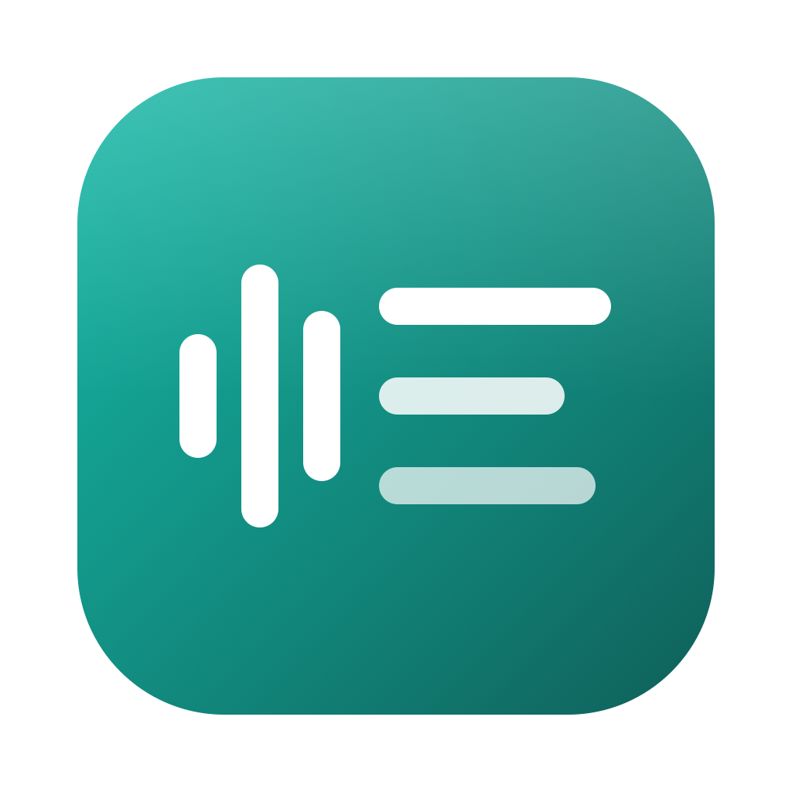
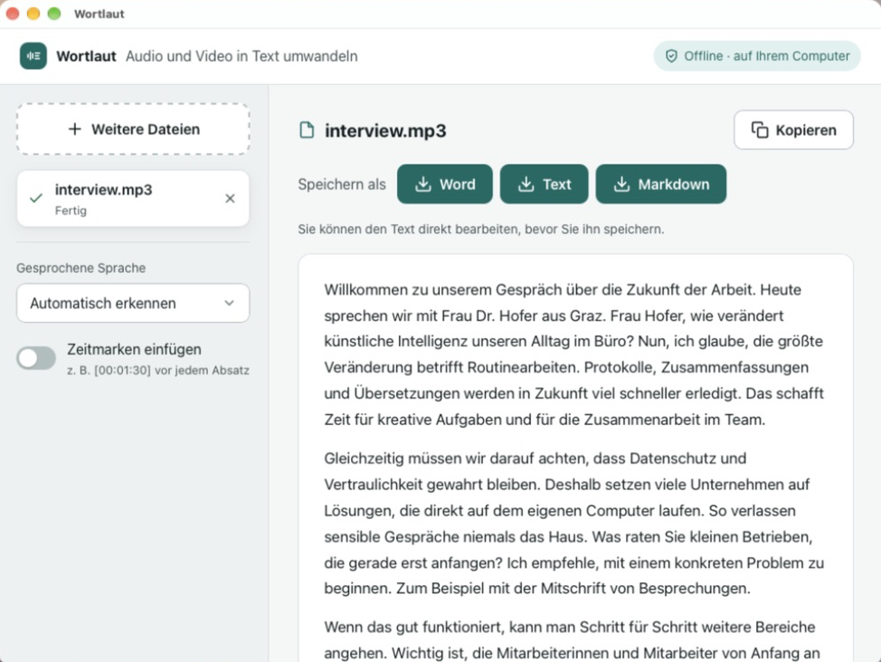
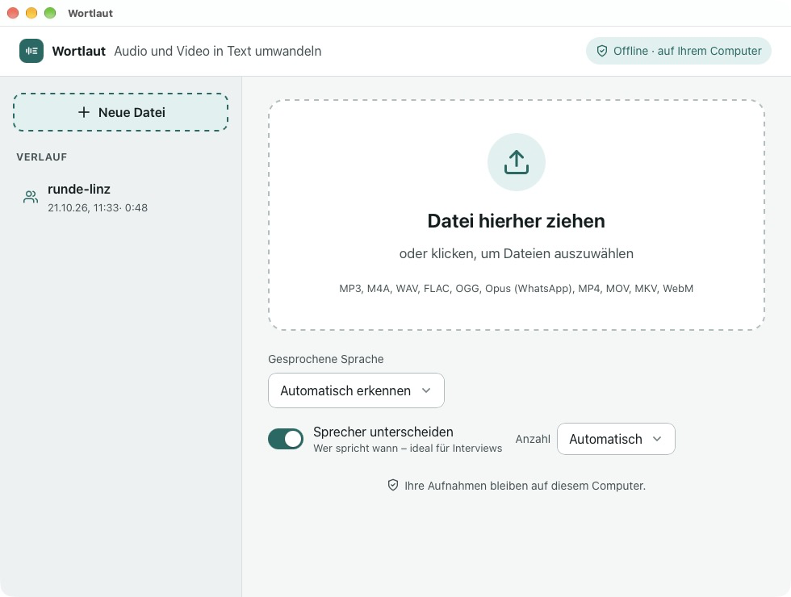
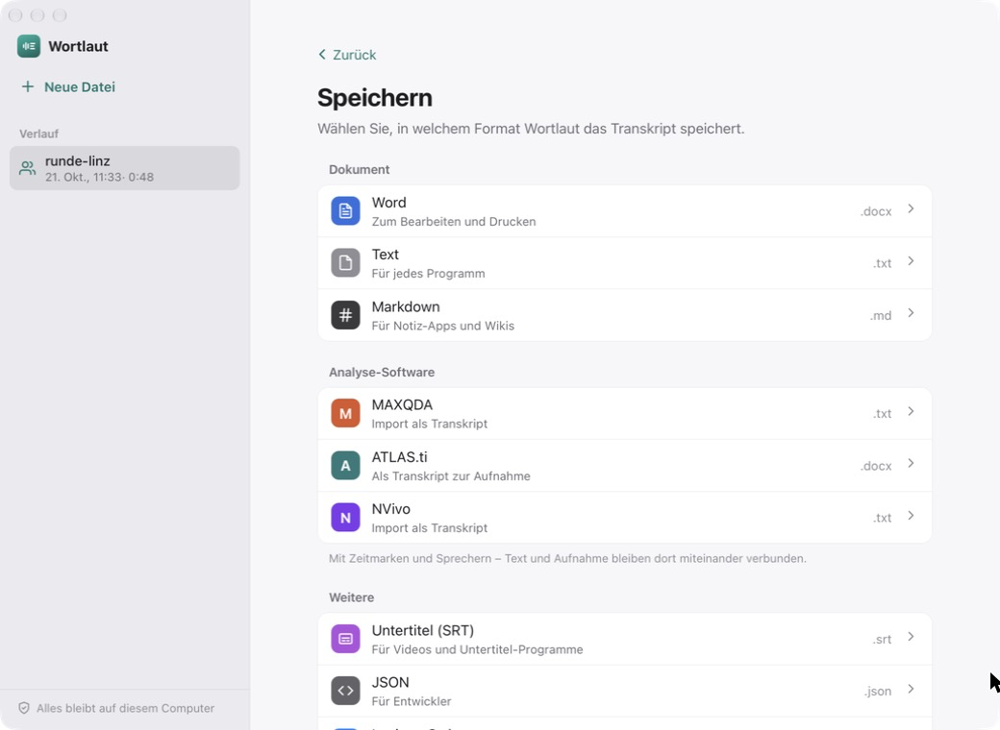
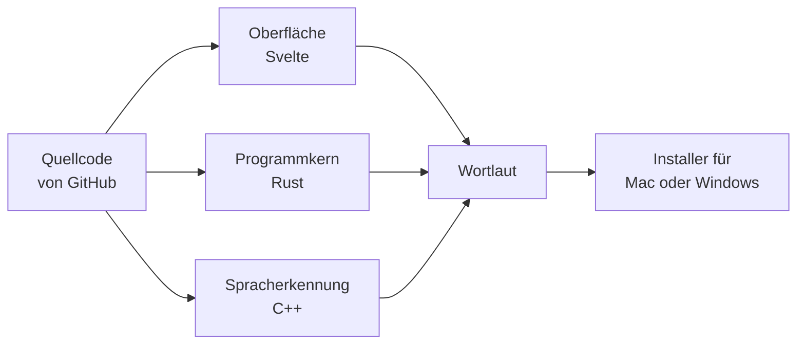

<div align="center">



# Wortlaut

**Audio und Video in Text umwandeln – kostenlos, offline, auf Ihrem Computer.**

[**⬇ Für Mac herunterladen**](https://github.com/zdkderpphb/wortlaut/releases/latest/download/Wortlaut-Mac.dmg)
&nbsp;&nbsp;·&nbsp;&nbsp;
[**⬇ Für Windows herunterladen**](https://github.com/zdkderpphb/wortlaut/releases/latest/download/Wortlaut-Windows-setup.exe)

<sub>Lieber aus dem Quellcode? [Selbst bauen](#selbst-bauen)</sub>



</div>

---

## So einfach geht's

1. **Installieren** – Laden Sie die Datei für Ihren Computer herunter und öffnen Sie sie.
2. **Einmal einrichten** – Beim ersten Start lädt Wortlaut sein Sprachmodell (ca. 3 GB).
   Das dauert je nach Internet 5 bis 15 Minuten und passiert nur ein einziges Mal.
3. **Datei hineinziehen** – Ziehen Sie eine Aufnahme ins Fenster. Der Text erscheint,
   und Sie speichern ihn mit einem Klick als **Word**, **Text** oder **Markdown**.
   Bei Interviews und Gesprächen schalten Sie vorher **Sprecher unterscheiden** ein.

Das war's. Ab jetzt funktioniert Wortlaut auch ohne Internet.

<div align="center">

</div>

## Was Wortlaut kann

- **Privat:** Ihre Aufnahmen verlassen den Computer nie. Keine Cloud, kein Konto, keine Kosten.
- **Fast jede Datei:** MP3, M4A, WAV, FLAC, OGG, WhatsApp-Sprachnachrichten (Opus),
  und Videos wie MP4, MOV, MKV oder WebM.
- **8 Sprachen:** Deutsch, Englisch, Französisch, Spanisch, Italienisch, Portugiesisch,
  Niederländisch und Hindi – auf Wunsch automatisch erkannt.
- **Sprecher unterscheiden:** Wer spricht wann – für Interviews und Gruppen, beliebig viele
  Personen. Aus „Sprecher 1“ wird mit einem Klick „Interviewerin“.
- **Für Forschung und Analyse:** Unter **Speichern** finden Sie neben Word, Text und Markdown auch
  **MAXQDA**, **ATLAS.ti** und **NVivo** – mit Zeitmarken und Sprechern, sodass Text und Aufnahme dort verbunden sind.
- **Untertitel:** Als SRT-Datei für Videos.
- **Zusammenfassung:** Auf Knopfdruck die wichtigsten Punkte eines Gesprächs.
- **Bequem korrigieren:** Text direkt bearbeiten, Stelle anhören (▶ neben jedem Absatz),
  falsch erkannte Namen mit **Suchen & Ersetzen** überall auf einmal ändern.
- **Nichts geht verloren:** Alle Transkripte bleiben im Verlauf, Änderungen werden automatisch gespeichert.
- **Mehrere Dateien:** Einfach alle auf einmal hineinziehen – sie werden der Reihe nach umgewandelt.

<div align="center">

</div>

## Beim ersten Öffnen

Wortlaut ist noch nicht bei Apple und Microsoft registriert. Ihr Computer fragt deshalb
beim ersten Öffnen einmal nach. So geht es weiter:

<details>
<summary><b>Mac</b></summary>

1. Öffnen Sie die heruntergeladene Datei `Wortlaut-Mac.dmg` und ziehen Sie **Wortlaut**
   in den Ordner **Programme**.
2. Starten Sie Wortlaut. Es erscheint eine Meldung, dass die App nicht geöffnet wurde –
   klicken Sie auf **Fertig**.
3. Öffnen Sie **Systemeinstellungen → Datenschutz & Sicherheit**, scrollen Sie nach unten
   und klicken Sie bei „Wortlaut“ auf **Dennoch öffnen**.
4. Bestätigen Sie mit Ihrem Passwort. Ab jetzt startet Wortlaut ganz normal.

</details>

<details>
<summary><b>Windows</b></summary>

1. Öffnen Sie die heruntergeladene Datei `Wortlaut-Windows-setup.exe`.
2. Erscheint „Der Computer wurde durch Windows geschützt“, klicken Sie auf
   **Weitere Informationen** und dann auf **Trotzdem ausführen**.
3. Die Installation braucht keine Administrator-Rechte. Wortlaut finden Sie danach im Startmenü.

</details>

## Was Ihr Computer braucht

|                | Mac                                 | Windows                          |
| -------------- | ----------------------------------- | -------------------------------- |
| System         | macOS 13 oder neuer                 | Windows 10 oder 11 (64 Bit)      |
| Prozessor      | Apple-Chip (M1 oder neuer)          | jeder aktuelle Intel- oder AMD-Prozessor |
| Arbeitsspeicher| 8 GB, besser 16 GB                  | 8 GB, besser 16 GB               |
| Speicherplatz  | 4 GB frei                           | 4 GB frei                        |

**Wie schnell?** Auf einem Mac mit Apple-Chip ist eine Stunde Aufnahme meist in 5 bis 15 Minuten
fertig. Unter Windows nutzt Wortlaut die Grafikkarte, wenn möglich. Ohne passende Grafikkarte
dauert die Umwandlung etwa so lange wie die Aufnahme selbst.

## Häufige Fragen

<details>
<summary><b>Werden meine Aufnahmen irgendwohin geschickt?</b></summary>

Nein. Wortlaut verbindet sich nur ein einziges Mal mit dem Internet, um das Sprachmodell
herunterzuladen. Die Umwandlung passiert vollständig auf Ihrem Computer.
</details>

<details>
<summary><b>Wie genau ist der Text?</b></summary>

Bei deutlicher Sprache sehr genau. Namen, Fachbegriffe und Gespräche, in denen viele
durcheinander reden, sollten Sie kurz gegenlesen.
</details>

<details>
<summary><b>Wie gut unterscheidet Wortlaut die Sprecher?</b></summary>

Bei Interviews und Gesprächsrunden mit klar getrennten Wortbeiträgen sehr zuverlässig.
Sehr kurze Einwürfe („Mhm“, „Genau“) und Stellen, an denen mehrere gleichzeitig sprechen,
landen manchmal beim falschen Namen – ein kurzer Blick beim Gegenlesen genügt.
Wenn Sie wissen, wie viele Personen sprechen, wählen Sie die **Anzahl** aus; das hilft.
</details>

<details>
<summary><b>Wie übernehme ich ein Transkript in MAXQDA, ATLAS.ti oder NVivo?</b></summary>

Klicken Sie auf **Speichern …** und wählen Sie Ihr Programm. Die Datei enthält Zeitmarken und Sprecher.

- **MAXQDA:** *Import → Transkripte (mit Zeitmarken)* und die Audiodatei zuordnen.
- **ATLAS.ti:** Die Aufnahme als Dokument hinzufügen und die Word-Datei als Transkript damit verknüpfen.
- **NVivo:** Bei der Audiodatei *Transkript importieren*, Spalten *Zeitspanne*, *Sprecher*, *Inhalt*.
</details>

<details>
<summary><b>Der Download ist abgebrochen. Muss ich von vorne anfangen?</b></summary>

Nein. Starten Sie Wortlaut neu und klicken Sie auf **Einrichtung fortsetzen** –
der Download macht dort weiter, wo er aufgehört hat.
</details>

<details>
<summary><b>Etwas funktioniert nicht – was tun?</b></summary>

Bei einer Fehlermeldung finden Sie unter **Technische Details** einen Link
**Protokoll öffnen**. Schicken Sie uns diese Datei gerne mit einer kurzen Beschreibung als
[Fehlermeldung auf GitHub](https://github.com/zdkderpphb/wortlaut/issues/new).
</details>

<details>
<summary><b>Wie entferne ich Wortlaut wieder?</b></summary>

- **Mac:** Wortlaut aus dem Ordner *Programme* in den Papierkorb ziehen. Sprachmodelle und Verlauf liegen unter
  `~/Library/Application Support/io.github.zdkderpphb.wortlaut` und können ebenfalls gelöscht werden.
- **Windows:** *Einstellungen → Apps → Wortlaut → Deinstallieren*. Sprachmodelle und Verlauf liegen unter
  `%LOCALAPPDATA%\io.github.zdkderpphb.wortlaut`.
</details>

## Selbst bauen

Wortlaut ist offener Quellcode. Statt den fertigen Installer zu laden, können Sie das Programm
deshalb auch selbst bauen – etwa um genau zu wissen, was auf Ihrem Computer läuft.
Programmieren müssen Sie dafür nicht: Sie installieren ein paar Werkzeuge, kopieren einige
Befehle und warten.



Ihr Computer übersetzt drei Bausteine und fügt sie zu einem Programm samt Installer zusammen.
Beim ersten Mal dauert das eine Weile, vor allem die Spracherkennung ist ein großes Stück
Software. Jeder weitere Bau geht deutlich schneller.

|                          | Mac                                     | Windows                     |
| ------------------------ | --------------------------------------- | --------------------------- |
| Computer                 | Apple-Chip (M1 oder neuer), macOS 13+   | Windows 10 oder 11 (64 Bit) |
| Freier Speicherplatz     | etwa 10 GB                              | etwa 20 GB                  |
| Zeit beim ersten Mal     | etwa 30 bis 45 Minuten                  | etwa 1 Stunde               |
| Internet                 | während der Installation und beim Bauen | während der Installation und beim Bauen |

Ein selbst gebautes Wortlaut öffnet sich in der Regel ohne die Nachfrage aus
[Beim ersten Öffnen](#beim-ersten-öffnen) – es wurde ja nicht aus dem Internet geladen.

<details>
<summary><b>Auf dem Mac</b></summary>

Alle Befehle kopieren Sie ins **Terminal** (*Programme → Dienstprogramme → Terminal*)
und bestätigen sie mit der Eingabetaste.

**1. Apples Entwicklerwerkzeuge installieren**

```bash
xcode-select --install
```

Es erscheint ein Fenster – klicken Sie auf **Installieren**. Meldet das Terminal
„already installed“, sind die Werkzeuge schon da.

**2. Homebrew installieren.** Damit holen Sie die übrigen Werkzeuge. Die erste Zeile stammt von
[brew.sh](https://brew.sh), die beiden anderen machen Homebrew im Terminal bekannt.
Haben Sie Homebrew schon, überspringen Sie diesen Schritt.

```bash
/bin/bash -c "$(curl -fsSL https://raw.githubusercontent.com/Homebrew/install/HEAD/install.sh)"
echo 'eval "$(/opt/homebrew/bin/brew shellenv)"' >> ~/.zprofile
eval "$(/opt/homebrew/bin/brew shellenv)"
```

**3. Node.js, CMake und Rust installieren**

```bash
brew install node cmake
curl --proto '=https' --tlsv1.2 -sSf https://sh.rustup.rs | sh -s -- -y
source "$HOME/.cargo/env"
```

**4. Wortlaut holen und bauen**

```bash
git clone https://github.com/zdkderpphb/wortlaut.git
cd wortlaut
npm install
npm run tauri build
```

Jetzt arbeitet Ihr Computer eine Weile. Zum Schluss steht im Terminal **Finished** und darunter,
wo die fertigen Dateien liegen.

**5. Installieren**

```bash
open src-tauri/target/release/bundle/dmg
```

Öffnen Sie im Fenster die Datei `Wortlaut_…_aarch64.dmg` und ziehen Sie Wortlaut in den Ordner
**Programme** – genau wie bei der fertigen Version.

</details>

<details>
<summary><b>Unter Windows</b></summary>

Alle Befehle kopieren Sie in die **Eingabeaufforderung** (Startmenü öffnen, `cmd` eintippen,
Eingabetaste) und bestätigen sie mit der Eingabetaste.

**1. Werkzeuge installieren.** Windows bringt dafür das Programm `winget` mit. Fragt Windows,
ob Änderungen erlaubt sind, klicken Sie auf **Ja**. Die erste Zeile holt Microsofts
C++-Werkzeuge – sie ist die größte und dauert am längsten.

```bat
winget install -e --id Microsoft.VisualStudio.2022.BuildTools --accept-package-agreements --accept-source-agreements --override "--passive --wait --add Microsoft.VisualStudio.Workload.VCTools --includeRecommended"
winget install -e --id Rustlang.Rustup --accept-package-agreements --accept-source-agreements
winget install -e --id OpenJS.NodeJS.LTS --accept-package-agreements --accept-source-agreements
winget install -e --id Kitware.CMake --accept-package-agreements --accept-source-agreements
winget install -e --id KhronosGroup.VulkanSDK --accept-package-agreements --accept-source-agreements
winget install -e --id Git.Git --accept-package-agreements --accept-source-agreements
```

**2. Eingabeaufforderung schließen und neu öffnen.** Erst ein neues Fenster kennt die neuen
Werkzeuge.

**3. Wortlaut holen und bauen**

```bat
rustup default stable
git clone https://github.com/zdkderpphb/wortlaut.git
cd wortlaut
npm install
npm run tauri build
```

Jetzt arbeitet Ihr Computer eine Weile. Zum Schluss steht in der Eingabeaufforderung
**Finished** und darunter, wo der fertige Installer liegt.

**4. Installieren**

```bat
explorer src-tauri\target\release\bundle\nsis
```

Doppelklicken Sie im Fenster auf `Wortlaut_…_x64-setup.exe` – fertig.

</details>

<details>
<summary><b>Wenn etwas nicht klappt</b></summary>

- **„Befehl nicht gefunden“** (*command not found* bzw. *… ist nicht als interner oder externer
  Befehl erkannt*): Schließen Sie das Fenster und öffnen Sie ein neues. Frisch installierte
  Werkzeuge kennt erst ein neues Fenster.
- **Der Bau bricht ab:** Starten Sie `npm run tauri build` einfach noch einmal – schon Gebautes
  bleibt erhalten. Hilft das nicht, schicken Sie die letzten Zeilen der Ausgabe als
  [Fehlermeldung auf GitHub](https://github.com/zdkderpphb/wortlaut/issues/new).
- **Eine neue Version bauen:** Im Ordner `wortlaut` zuerst `git pull`, dann wieder `npm install`
  und `npm run tauri build`.
- **Nur ausprobieren, ohne zu installieren:** `npm run tauri dev` startet Wortlaut direkt aus
  dem Quellcode.

</details>

---

## Für Entwickler

Wortlaut ist eine [Tauri 2](https://tauri.app)-App: Oberfläche in Svelte 5, Kern in Rust.
Die Spracherkennung läuft über [transcribe.cpp](https://github.com/handy-computer/transcribe.cpp)
(Metal auf dem Mac, Vulkan oder CPU unter Windows) mit
[Voxtral Mini 3B](https://huggingface.co/mistralai/Voxtral-Mini-3B-2507) von Mistral AI
in der 4-Bit-Fassung (`Q4_K_M`). Sprecher erkennt [sherpa-onnx](https://github.com/k2-fsa/sherpa-onnx)
mit pyannote-Segmentierung und CAM++-Stimmmerkmalen.

```bash
npm install
npm run tauri dev       # App im Entwicklungsmodus starten
npm run tauri build     # Installer bauen
```

Voraussetzungen: Node.js, Rust (stable) und CMake, unter Windows zusätzlich die Visual Studio
Build Tools (C++) und das [Vulkan SDK](https://vulkan.lunarg.com/sdk/home) – Schritt für Schritt
unter [Selbst bauen](#selbst-bauen).

**Tests**

```bash
npm test                                   # Oberfläche (vitest)
npm run build && cargo test --manifest-path src-tauri/Cargo.toml --lib
# mit echten Modellen (Ordner aus der App):
WORTLAUT_MODEL=<ordner>/Voxtral-Mini-3B-2507-Q4_K_M.gguf WORTLAUT_DIARIZE_MODELS=<ordner> \
  cargo test --manifest-path src-tauri/Cargo.toml --lib
```

**Aufbau**

| Ordner / Datei                  | Aufgabe                                                   |
| ------------------------------- | --------------------------------------------------------- |
| `src/lib/`                      | Oberfläche: Einrichtung, Warteliste, Ergebnis, Texte (de/en) |
| `src-tauri/src/audio.rs`        | Audio und Video lesen, auf 16 kHz mono umrechnen          |
| `src-tauri/src/chunker.rs`      | Aufnahmen in 20–30-s-Abschnitte teilen, in Sprechpausen   |
| `src-tauri/src/diarize.rs`      | Sprecher erkennen (sherpa-onnx)                           |
| `src-tauri/src/pieces.rs`       | Aus Sprecherabschnitten umwandelbare Beiträge bilden      |
| `src-tauri/src/engine.rs`       | Voxtral laden, Sprache bestimmen, Beiträge umwandeln      |
| `src-tauri/src/summary.rs`      | Zusammenfassung mit Voxtral                               |
| `src-tauri/src/history.rs`      | Verlauf: Transkripte als JSON speichern                   |
| `src-tauri/src/model_manager.rs`| Modelle herunterladen (fortsetzbar, mit Prüfsumme)        |
| `src-tauri/src/export.rs`       | Word, Text, Markdown, SRT, MAXQDA, ATLAS.ti, NVivo, JSON    |
| `src-tauri/src/commands.rs`     | Verbindung zwischen Oberfläche und Rust                   |

**Neue Version veröffentlichen:** Versionsnummer in `package.json`, `src-tauri/Cargo.toml` und
`src-tauri/tauri.conf.json` erhöhen, dann `git tag v0.2.0 && git push --tags`. GitHub Actions baut
beide Installer, prüft sie mit einem Selbsttest und legt einen Release-Entwurf an. Nach dem
Veröffentlichen zeigen die Download-Links oben automatisch auf die neue Version.
Signierung für Mac und Windows: siehe [docs/SIGNING.md](docs/SIGNING.md).

## Lizenz und Dank

Wortlaut steht unter der [MIT-Lizenz](LICENSE).
Es baut auf großartiger offener Arbeit auf: dem Sprachmodell **Voxtral** von
[Mistral AI](https://mistral.ai) (Apache 2.0), **transcribe.cpp** und **ggml** (MIT),
**Tauri**, **Symphonia** und **libopus**. Details in [THIRD-PARTY-NOTICES.md](THIRD-PARTY-NOTICES.md).
„Voxtral“ ist eine Marke von Mistral AI; Wortlaut ist kein Produkt von Mistral AI.
